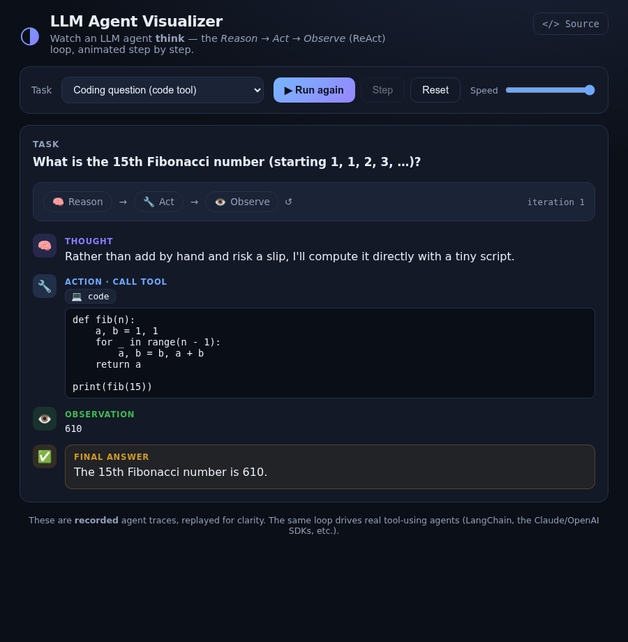

# LLM Agent Visualizer

An interactive visualization of **how an LLM agent thinks** — the *Reason → Act → Observe* (**ReAct**) loop, animated one step at a time.

> **Live demo:** https://tongchen2010.github.io/llm-agent-visualizer/



---

## What it shows

Modern AI agents don't answer in one shot. They run a loop:

1. **Reason** — the model writes a *thought* about what to do next.
2. **Act** — it calls a *tool* (web search, calculator, code, …) with some input.
3. **Observe** — it reads the tool's result.
4. …and repeats until it can give a final answer.

This app replays recorded agent traces so you can *watch* that loop unfold: each thought, tool call, and observation appears in sequence, with the active phase highlighted. Pick a task, press **Run**, or use **Step** to walk through it manually.

## Why it's built on recorded traces

A live agent needs a paid LLM API key, which can't be safely embedded in a static page. So the demo ships **recorded traces** — the exact structure real agents produce — which means it runs instantly, for free, with no key and no backend. The same loop drives real tool-using agents in LangChain, the Claude/OpenAI SDKs, and MCP-based systems.

## Features

- Four tasks covering different tool types: web search, calculator, code execution, and Wikipedia lookup.
- **Play / Pause / Step** controls and an adjustable replay speed.
- Live **ReAct phase tracker** and iteration counter.
- Token-by-token "typing" for thoughts and answers; a tool-running spinner for observations.
- Pure HTML/CSS/JS — no dependencies, no build step.

## Run locally

```bash
python3 -m http.server 8000
# open http://localhost:8000/
```

## Deploy to GitHub Pages

Push to a repo, then **Settings → Pages → Deploy from a branch → `main` / `(root)`**. The included `.nojekyll` serves files as-is.

## Extending it to live agents

Swap the recorded traces for a real loop: on each iteration, send the running transcript to an LLM (via a *bring-your-own-key* field or a small serverless proxy), parse its `Thought / Action / Action Input`, execute the named tool in JS, append the `Observation`, and repeat until the model emits a final answer. The UI here is already structured around exactly those step types.

## License

MIT © Tong Chen
